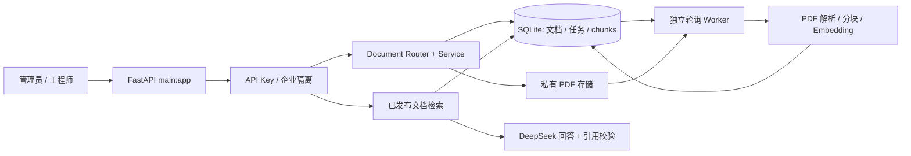

# 企业 AI 知识库助手 · V1.0 发布候选版

一个面向设备售后工程师的可运行作品：管理员上传设备 PDF，独立 Worker 提取文字并建立向量索引，审核发布后工程师才能按企业与设备型号检索、提问，并查看页码和原文引用。它展示从 HTTP、事务、异步任务到 RAG 证据校验的完整业务闭环；不是已经上线的商业服务。

## 解决的问题与当前能力

企业设备手册分散、版本混用，工程师难以快速找到有依据的排障步骤。V1.0 通过 `organization_id` 和设备型号限制检索范围，文档先入 `review`，发布后才进入问答知识源。问答要求模型给出有效的 `[资料N]` 引用；没有证据或引用无效时，返回不足/待复核状态，而不是伪造来源。

| 能力 | 当前实现 |
| --- | --- |
| 企业管理员与工程师 | `X-API-Key` 映射服务端组织和角色；管理员负责建档、上传、发布 |
| PDF 入库 | `application/pdf` 原始请求体，最多 50 MB；SHA-256 校验与临时文件原子替换 |
| Worker | SQLite 条件领取、`lease_token`、续租、过期恢复、有限数据库退避与提交核对 |
| 文档生命周期 | `processing → review → published`，失败任务和版本替换均有状态约束 |
| RAG 问答 | SiliconFlow Embedding、按企业/型号/已发布状态过滤、DeepSeek 回答与引用校验 |
| 原有功能 | 旧工单、知识库、PDF 问答及 Agent 端点保留；启用试点 API Key 后旧匿名路由被屏蔽 |

技术栈：Python、FastAPI、Pydantic、SQLite（WAL）、PyMuPDF、SiliconFlow Embedding、DeepSeek；标准库 `unittest`。当前无需 Redis 或 Celery。源码语法要求 **Python ≥3.10**；本发布候选版的自动化测试实际运行于 **Python 3.15.0**，其他版本尚未逐一验证。



详见 [架构与数据流](docs/architecture.md) 和 [面试技术亮点](docs/interview-highlights.md)。

## 目录速览

```text
main.py                         完整业务路由入口（V1.0 演示使用）
app/main.py                     共享 FastAPI 实例；迁移中的较小路由集合
app/core/                       应用工厂、试点鉴权
app/api/routes/documents.py     上传、详情、发布 HTTP 层
app/services/                   文档、入库准备、任务租约服务
database.py                     SQLite schema 与兼容迁移
pdf_rag_service.py              现有 Worker、PDF 分块与版本化检索
pdf_service.py                  PDF 文字解析
embedding_service.py            SiliconFlow Embedding
deepseek_client.py              DeepSeek 调用
pdf_chat_service.py             问答与引用校验
demo/                           原创公开 PDF 与操作步骤
docs/                           架构、面试材料
test_*.py                       离线测试（临时 SQLite）
```

## 安装与配置

在仓库根目录，Windows PowerShell：

```powershell
py -3 -m venv .venv
.\.venv\Scripts\python.exe -m pip install -r requirements.txt
New-Item -ItemType Directory -Force -Path .\data, .\storage | Out-Null
```

Linux/macOS：`python3 -m venv .venv && .venv/bin/python -m pip install -r requirements.txt`，然后创建 `data/` 与 `storage/`。所有命令均在仓库根目录运行。

查看 [.env.example](.env.example)。**程序不会自动读取 `.env` 文件**，必须在启动 API 和 Worker 的环境中设置变量；`.env.example` 中的 API Key 是故意无法通过长度校验的占位符，必须自行生成随机 Key，不能当作真实密钥使用。

| 环境变量 | 用途 |
| --- | --- |
| `PILOT_API_KEYS` | JSON 对象：随机 API Key → `{ "organization_id": 1, "role": "admin"/"engineer" }`；每个 Key 至少 32 字符 |
| `DATABASE_PATH` | 两进程共用 SQLite 文件；默认项目根目录 `tickets.db`，建议显式设为私有 `data/pilot.db` |
| `DOCUMENT_STORAGE_PATH` | 两进程共用 PDF 私有目录；上传接口要求设置 |
| `PDF_INGESTION_MODE` | `worker` 为持续 Worker 模式；默认 `background` **只适合开发** |
| `SILICONFLOW_API_KEY` | Worker 生成 Embedding、问答检索所需 |
| `DEEPSEEK_API_KEY` | 有证据时生成回答所需 |
| `DEEPSEEK_MODEL` | 可选，默认 `deepseek-chat` |

PowerShell 示例（请换成自行生成的随机 Key，勿提交终端历史或含密钥文件）：

```powershell
$adminKey = & .\.venv\Scripts\python.exe -c "import secrets; print(secrets.token_urlsafe(32))"
$engineerKey = & .\.venv\Scripts\python.exe -c "import secrets; print(secrets.token_urlsafe(32))"
$keys = @{}
$keys[$adminKey] = @{ organization_id = 1; role = 'admin' }
$keys[$engineerKey] = @{ organization_id = 1; role = 'engineer' }
$env:PILOT_API_KEYS = ConvertTo-Json -Compress -Depth 4 $keys
$env:DATABASE_PATH = Join-Path (Get-Location).Path 'data\pilot.db'
$env:DOCUMENT_STORAGE_PATH = Join-Path (Get-Location).Path 'storage'
$env:PDF_INGESTION_MODE = 'worker'
$env:SILICONFLOW_API_KEY = '<your-private-key>'
$env:DEEPSEEK_API_KEY = '<your-private-key>'
```

不要原样使用尖括号占位符。无模型密钥时可运行离线测试，但不能完成真实 Embedding / DeepSeek 演示。

## 启动与业务演示

API 使用**完整业务入口**：

```powershell
.\.venv\Scripts\python.exe -m uvicorn main:app --host 127.0.0.1 --port 8000
```

另开终端，设置**相同**的 `DATABASE_PATH`、`DOCUMENT_STORAGE_PATH` 和 `PDF_INGESTION_MODE=worker`，持续运行：

```powershell
.\.venv\Scripts\python.exe pdf_rag_service.py work --poll-seconds 3
```

本阶段 `uvicorn app.main:app` 虽可启动，但不包含仍留在根 `main.py` 的组织、设备型号、任务查询和问答路由，不能用于完整演示。访问 `http://127.0.0.1:8000/health` 和 `/docs` 检查 API；两进程必须共享数据库和存储目录。演示的完整 PowerShell 请求与预期状态见 [demo/README.md](demo/README.md)。上传不是 multipart：使用 `application/pdf` 原始字节，`family_key`、`version`、`title`、`device_model_ids` 均在查询参数。

业务顺序：初始化企业和设备型号 → 上传 [原创 X100 演示 PDF](demo/assets/asteredge_x100_guide.pdf) → 得到 `document_id` / `job_id` → Worker 入库 → 状态 `succeeded` / `review` → 管理员发布 → `POST /v1/answers` 提问 → 检查 `references` 的文档 ID、页码与内容。发布前问答应为 `insufficient_evidence`。跨企业详情、发布和任务查询返回 404，跨企业型号问答返回 404。

## 权限、可靠性与边界

- API Key 在服务端映射组织身份，客户端不能通过请求体指定 `organization_id`；文档详情、发布、任务查询与向量检索均按组织过滤。工程师不能上传或发布。
- `claim_job()` 使用 SQLite 事务与条件更新。每次领取生成新 `lease_token`，提交/失败/续租核对活租约；成功提交将 `completed_lease_token` 与 chunks、文档及任务状态放在同一事务，避免旧执行者误认新执行者的结果。旧成功记录缺少此标识时不猜测归属。
- Worker 每轮检查过期租约。SQLite `BUSY`/`LOCKED`/`IOERR` 采用有限指数退避（最多 5 次），不可恢复错误会退出供进程管理器处理。尝试上限 3；无租约历史任务只能经显式人工检查与恢复脚本处理。
- `background` 模式的 FastAPI `BackgroundTasks` 在 API 进程崩溃后**不能保证恢复**。生产环境必须使用独立、持续运行的 Worker，并由 systemd、容器编排或其他外部进程管理器负责重启、日志与告警。本仓库尚未提供已验收的生产监管配置。
- SQLite 适合单机演示/试点，不承诺多机扩展、灾备或高并发。PDF 仅做大小与头部初检，扫描件 OCR、恶意文件扫描尚未实现。模型输出需要人工复核，不能用于真实设备维修的唯一依据。
- 旧匿名端点保留兼容，但当 `PILOT_API_KEYS` 被配置时由中间件屏蔽，避免把未隔离的旧 Agent / PDF 路由暴露为企业生产接口。

历史无租约任务：确认旧 Worker 已停止、数据库已备份后，先执行 `python recover_legacy_ingestion_jobs.py`（只读），检查报告，再考虑 `python recover_legacy_ingestion_jobs.py --apply --confirm-old-workers-stopped`。不会在 API 启动时自动重置 `running` 任务。

## 测试与路线

```powershell
.\.venv\Scripts\python.exe -m unittest -v test_demo_flow
.\.venv\Scripts\python.exe -m unittest -v test_ingestion_job_service test_worker_lease_integration test_worker_recovery
.\.venv\Scripts\python.exe -m unittest discover -v
.\.venv\Scripts\python.exe -m compileall -q app main.py database.py pdf_rag_service.py demo
```

`test_demo_flow.py` 使用可公开 PDF 和临时 SQLite，真实执行 FastAPI、PDF 解析、Worker、发布与隔离；Embedding 向量和 DeepSeek 文本是**模拟**的。真实外部模型联调需要自行配置密钥并检查费用，不能把离线测试视为真实模型调用成功。测试不会读写仓库已有 `tickets.db`、`manual.pdf` 或上传目录。

V1.0.1 受控真实模型与原创 PDF 闭环的记录、一次回答的人工逐项引用核对见 [验证记录](docs/real-model-validation.md)；这不等于生产部署验收。后续方向：更多问题的引用质量评估、可监管的部署模板、PDF OCR 与恶意文件扫描、数据库备份/恢复演练；不以继续拆分 Worker 文件作为当前发布条件。
