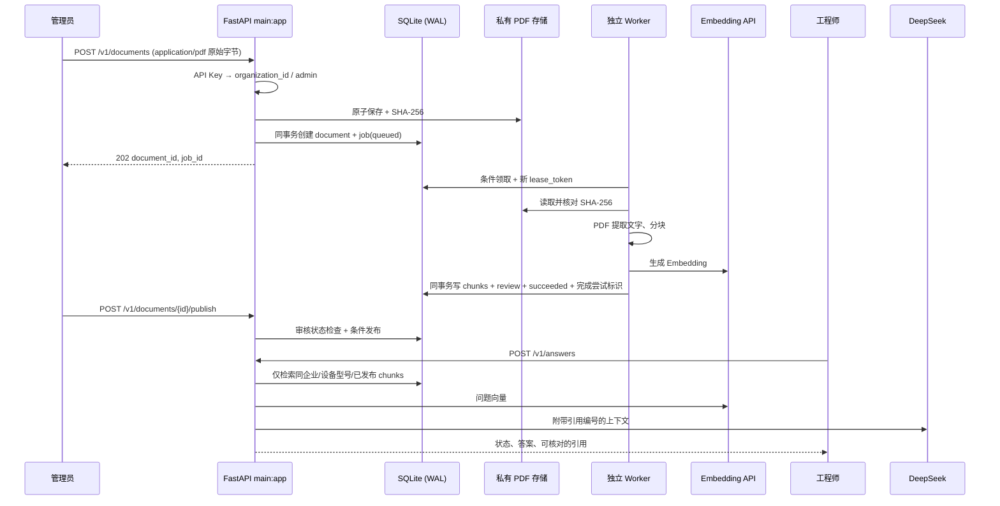

# V1.0 架构与数据流

## 模块边界

- `app/core/auth.py` 把 API Key 映射到服务端控制的组织和角色；旧匿名路由在试点模式下由 `app/core/factory.py` 中间件屏蔽。
- `app/api/routes/documents.py` 处理 HTTP 参数、鉴权与异常映射；`app/services/ingestion_service.py` 保存文件并事务创建任务；`app/services/document_service.py` 查询、发布文档。
- `app/services/ingestion_job_service.py` 拥有任务状态机与租约 SQL；`pdf_rag_service.py` 保留现有轮询 Worker、PDF/chunk 处理与检索。V1.0 不继续搬迁该文件。
- `pdf_chat_service.py` 只允许有效引用编号进入最终 `references`。没有证据时不调用生成模型。
- `database.py` 使用幂等 schema 迁移与 SQLite WAL；Worker 与 API 必须连接同一个文件及 PDF 目录。

## 状态与故障

任务 `queued → running → succeeded/failed`。过期且未到尝试上限的 `running` 可重新排队；新领取生成新 `lease_token`。旧 token 的续租、完成和失败写回均被拒绝。成功时持久化 `completed_lease_token`，可在数据库提交结果不确定时核对“是否由**本次**尝试成功”，不靠可复用的 `worker_id` 猜测。超过上限的过期任务与关联文档同事务失败；历史无租约 `running` 不自动重置。

SQLite 锁和 I/O 故障只有限重试；进程退出、断电、永久数据库故障需要外部进程监管和人工运维。`background` 模式不具备这些保证。仓库不包含经生产验证的监控、告警、备份或 SLA。
